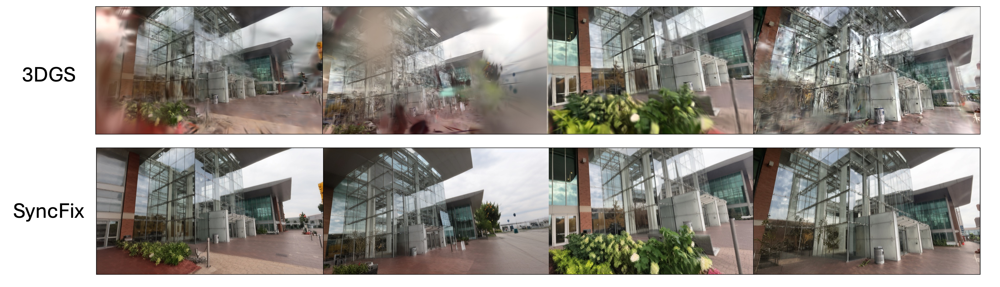
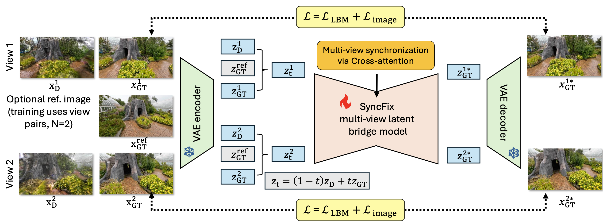

# SyncFix: Fixing 3D Reconstructions via Multi-View Synchronization

**Deming Li, Abhay Yadav, Cheng Peng, Rama Chellappa, Anand Bhattad**

[Project Page](https://syncfix.github.io/) | [Paper](https://arxiv.org/abs/2604.11797)



## Abstract
We present **SyncFix**, a framework that enforces cross-view consistency during the diffusion-based refinement of reconstructed scenes. SyncFix formulates refinement as a joint latent bridge matching problem, synchronizing distorted and clean representations across multiple views to fix the semantic and geometric inconsistencies. This means SyncFix learns a joint conditional over multiple views to enforce consistency throughout the denoising trajectory. Our training is done only on image pairs, but it generalizes naturally to an arbitrary number of views during inference. Moreover, reconstruction quality improves with additional views, with diminishing returns at higher view counts. Qualitative and quantitative results demonstrate that SyncFix consistently generates high-quality reconstructions and surpasses current state-of-the-art baselines, even in the absence of clean reference images. SyncFix achieves even higher fidelity when sparse references are available.



## Setup
```bash
conda create -n syncfix python=3.10
conda activate syncfix
pip install -e .
```

## Model Checkpoint
Please download the checkpoint [here](https://drive.google.com/drive/folders/1RWGIQig_rUqH8xJXpdIjiUNOKAX1A4qE?usp=sharing). The official model checkpoint is trained with official [DL3DV] (https://dl3dv-10k.github.io/DL3DV-10K/) dataset train-test split.

## Inference
Run the top-level `inference.py` script to refine a degraded rendering or a directory of renderings.

```bash
python inference.py \
  --input_image path/to/input_images \
  --ref_image path/to/reference_images \
  --model_path path/to/model \
  --output_dir output \
  --n_per_pass 3 \
  --ref_size 1
```

### Example
Examples images in this [folder/](examples) 

```bash
python inference.py \
  --input_image examples/degraded \
  --ref_image examples/reference \
  --model_path path/to/model \
  --output_dir output \
  --n_per_pass 3 \
  --ref_size 1
```

### Main arguments
- `--input_image`: Path to an input image or a directory of degraded renderings.
- `--ref_image`: Path to a clean reference image or a directory of reference images.
- `--model_path`: Path to local model weights or a Hugging Face model directory/repository.
- `--output_dir`: Directory where refined outputs are written.
- `--height`, `--width`: Resize resolution used before inference.
- `--n_per_pass`: Number of images processed together per forward pass.
- `--ref_size`: Number of reference images appended to each forward pass.
- `--colmap_path`: Optional COLMAP path for selecting closest training views as references.

## Dataset

SyncFix is trained on degraded 3DGS renderings paired with their clean ground truth. We
built our training data with the official
[3D Gaussian Splatting](https://github.com/graphdeco-inria/gaussian-splatting) codebase.

The scripts that build such a dataset from your own scenes live in
[data_creation/](data_creation) and run in three steps:

1. [`build_3dgs_pairs.py`](data_creation/build_3dgs_pairs.py) enumerates one job per
   (scene, sparsity level `K`, run) into a `jobs.jsonl`. Each job trains a 3DGS model on
   `K` sparse views and renders the held-out views at the iterations given by
   `--save_its`, so the renderings are degraded by both sparse supervision and
   underfitting.
2. [`run_jobs_multi_gpu.py`](data_creation/run_jobs_multi_gpu.py) executes that job file
   across several GPUs.
3. [`make_wds_shards_multi_with_ref.py`](data_creation/make_wds_shards_multi_with_ref.py)
   packs the renderings into WebDataset shards and splits them into train and eval.

Each shard sample is keyed `{scene}__{K}__{run}__{iteration}__{frame}` and holds the
degraded rendering (`png`), its clean ground truth (`gt.png`) and a clean reference view
of the same scene (`ref.png`). The key layout is not cosmetic: the training pipeline
parses the trailing frame index out of it to group nearby views into one multi-view
sample.

## Training

Point `train_shards` / `validation_shards` in [configs/train.yaml](configs/train.yaml)
at the shards produced above and run:

```bash
python train.py configs/train.yaml
```

Training uses every visible GPU through DDP. Restrict it with `CUDA_VISIBLE_DEVICES`.
[configs/train_smoke.yaml](configs/train_smoke.yaml) is a 100-step version of the same
setup, useful to check the pipeline before launching a full run.

### Main config options
- `pair_num_views`: number of nearby degraded views synchronized in one sample. One clean
  reference is appended on top, so the model sees `pair_num_views + 1` views per sample.
- `pair_window`: maximum frame distance allowed between the paired views.
- `use_ref`: treat the last view as a clean reference and exclude it from the losses.
- `pixel_loss_weight`, `use_l1_pixel_loss`, `use_ssim_loss`, `use_gram_loss`: terms of the
  pixel-space loss applied to the decoded prediction (LPIPS, L1, SSIM and VGG Gram).
- `selected_timesteps` / `prob`: the timesteps sampled along the bridge and their weights.
- `pretrained_path`: directory of a previous run to finetune from, instead of starting
  from the Stable Diffusion XL weights.

Only the denoiser is trained; the VAE, LPIPS and VGG networks stay frozen. Checkpoints and
a copy of the config are written to `save_ckpt_path`, which is directly usable as the
`--model_path` of `inference.py`.

## Cross-View Semantic Consistency Metric

**CVSC** matches keypoints between two views with RaCo/ALIKED and LightGlue, or alternative models, keeps the epipolar inliers of a fundamental-matrix RANSAC, then samples DINOv3 patch features at the matches and averages their cosine similarity. The score is averaged over the consecutive pairs of a view sequence.

The metric needs three dependencies beyond the base install:

```bash
pip install git+https://github.com/cvg/LightGlue.git
pip install git+https://github.com/cvg/RaCo.git
git clone https://github.com/facebookresearch/dinov3   # plus its pretrained weights
```

```bash
python eval_cvsc.py \
  --image_dir output \
  --dinov3_repo path/to/dinov3 \
  --dinov3_weights path/to/dinov3_vitl16_pretrain.pth \
  --output_json output/cvsc.json
```

Views are scored in sorted filename order, so the directory should hold one sequence of
a single scene. `syncfix.metrics.compute_cvsc` exposes the same computation for use
inside an evaluation loop.

### Acknowledgements
This project is built upon [LBM](https://github.com/gojasper/LBM), [Difix3D+](https://github.com/nv-tlabs/Difix3D), and [3DGS](https://github.com/graphdeco-inria/gaussian-splatting). We thank all the authors for their great work and for providing the code. We also thank Zhaoliang Zhang, who trained the official model checkpoint with a mixed-higher-resolution strategy.

## Citation
```bibtex
@article{li2026syncfix,
  title={SyncFix: Fixing 3D Reconstructions via Multi-View Synchronization},
  author={Li, Deming and Yadav, Abhay and Peng, Cheng and Chellappa, Rama and Bhattad, Anand},
  journal={arXiv preprint arXiv:2604.11797},
  year={2026}
}
```